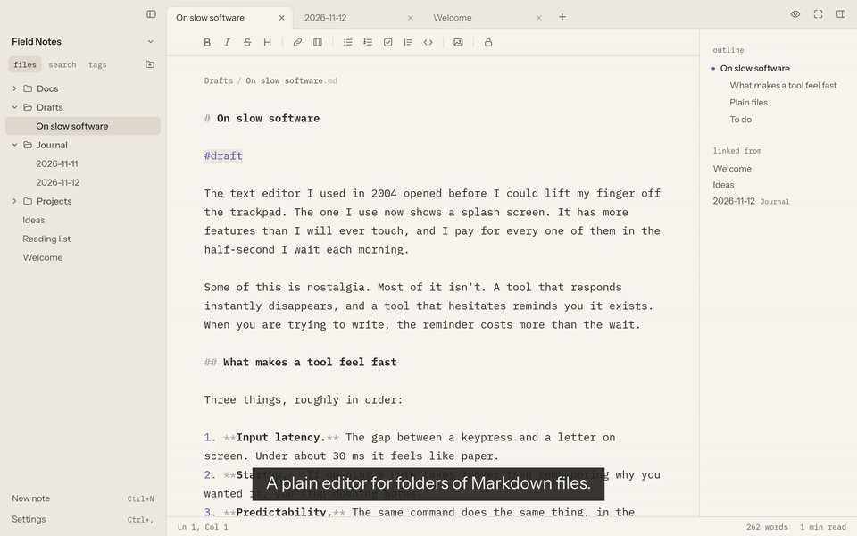
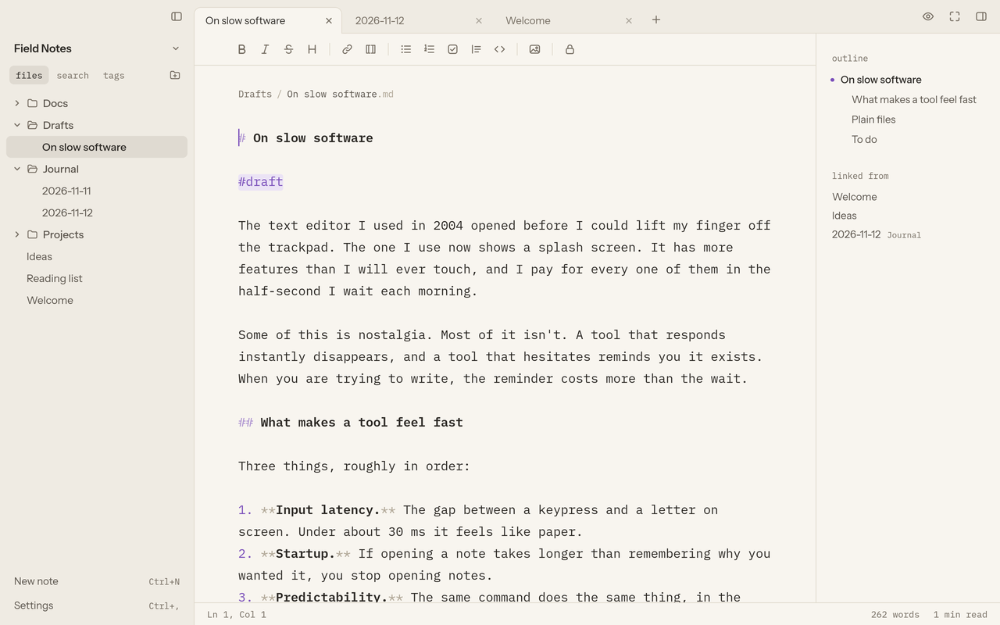
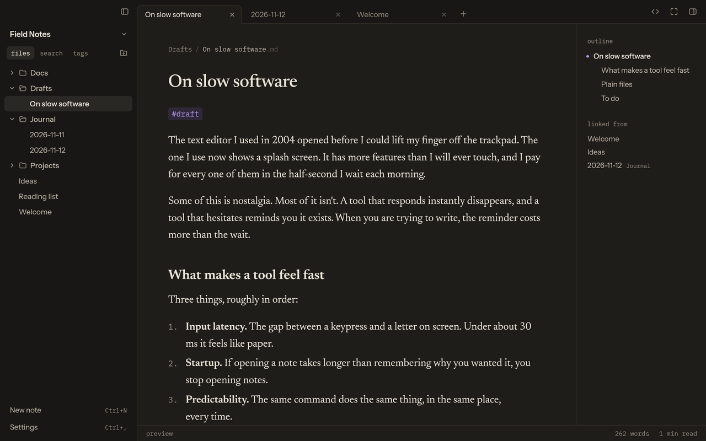
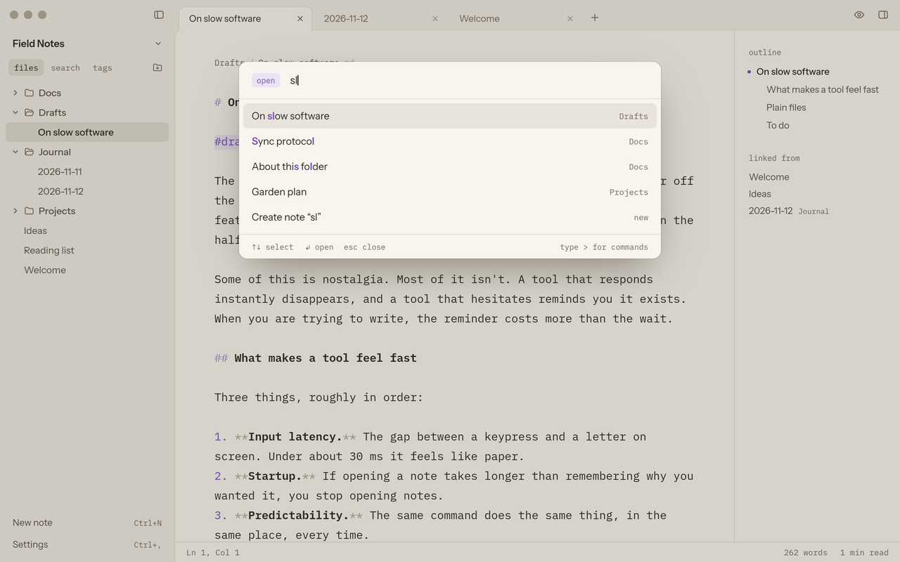
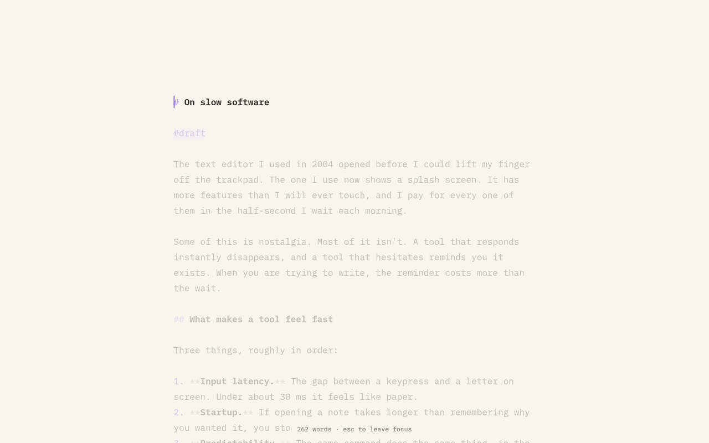
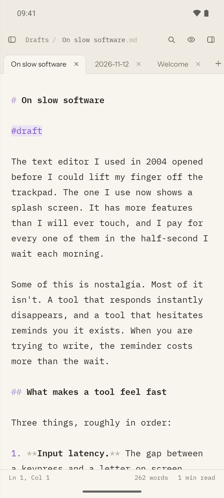
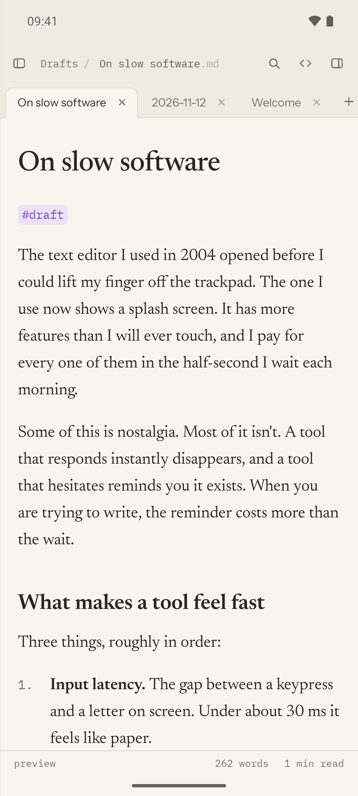
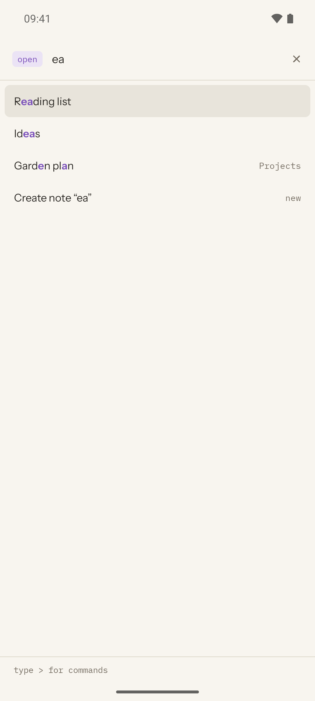

<p align="center">
  <picture>
    <source media="(prefers-color-scheme: dark)" srcset="assets/brand/mark-on-ink.svg">
    
  </picture>
</p>

<h1 align="center">quire</h1>

<p align="center">A plain editor for folders of Markdown files.<br>
Each note is a <code>.md</code> file on your disk, so any other app can open it.</p>

<p align="center">
  <a href="https://bjarneo.github.io/quire/">Website</a> ·
  <a href="#install">Install</a> ·
  <a href="#use-it-with-your-ai-tools">MCP server</a> ·
  <a href="site/assets/quire.mp4">Video</a>
</p>

<p align="center">
  <a href="site/assets/quire.mp4"></a>
</p>

## What you get

Quire opens a folder and edits the Markdown files in it. There is no database, no import step and no lock-in.

- **Write in Markdown.** Source mode highlights the syntax as you type, in a monospaced font. `Ctrl+E` switches to a preview that reads like a printed page.
- **Link notes.** Write `[[Note name]]` and `Ctrl`-click to follow it. A link to a missing note creates the note. Renaming a note rewrites the links to it.
- **Find anything.** `Ctrl+O` opens any note by a fuzzy name. `Ctrl+P` runs any command. `Ctrl+Shift+F` searches every note. Tags (`#idea`) get their own list.
- **Keep folders tidy.** Make folders in the file tree, drag notes into them, and use the `+` on a folder to make a note there. In the quick switcher, `Drafts/Idea` makes the note in `Drafts`.
- **Focus.** `Ctrl+.` hides everything but the text, dims the other paragraphs and keeps the line you type near the middle.
- **Look at home.** Light and dark themes, three editor fonts, and "Match system". On Omarchy, "Match system" takes the colours of your Omarchy theme.
- **Work with AI tools.** A built-in MCP server lets Claude Desktop, Cursor and other MCP clients read and search your notes.

<table>
  <tr>
    <td></td>
    <td></td>
  </tr>
  <tr>
    <td align="center">Source, light</td>
    <td align="center">Preview, dark</td>
  </tr>
  <tr>
    <td></td>
    <td></td>
  </tr>
  <tr>
    <td align="center">Quick switcher</td>
    <td align="center">Focus mode</td>
  </tr>
</table>

### On your phone

The Android app is the same editor for a phone: one pane, a drawer for the files, and tabs for open notes.

<p align="center">
  
  
  
</p>

## Install

Download the build for your system from the [latest release](https://github.com/bjarneo/quire/releases/latest):

| System | File |
| --- | --- |
| Linux, x86-64 | `quire-<version>-linux-x86_64.tar.gz`. Unpack it and run `./install.sh`. |
| macOS, Apple silicon | `quire-<version>-macos-arm64.zip`. The app is not notarized, so right-click it and choose **Open** the first time. |
| Windows, x86-64 | `quire-<version>-windows-x86_64.zip`. The app is not signed, so SmartScreen can warn you. |
| Android 8.0 and later | `quire-<version>-android.apk` |

Quire is pre-release. To build it yourself, follow the steps below.

### Desktop (Linux)

You need Rust and, on Linux, the `libxkbcommon` and `wayland` development packages. `rustup` installs the pinned toolchain on the first build.

```sh
git clone https://github.com/bjarneo/quire
cd quire/desktop
./install.sh        # builds, then installs quire, its icon and a launcher entry for your user
quire ~/notes       # or open Quire from the app launcher
```

The desktop app is built with [Rune](https://github.com/anomalyco/rune), a GPU-rendered Rust UI framework. Rune also targets macOS and Windows, but Quire is tested on Linux only. See [`desktop/README.md`](desktop/README.md).

### Android

You need JDK 21 and the Android SDK.

```sh
cd quire/android
./gradlew assembleDebug
adb install -r app/build/outputs/apk/debug/app-debug.apk
```

See [`android/README.md`](android/README.md).

## Use it with your AI tools

Turn on the server in Settings, MCP. Then paste the client configuration from that page into your AI app. With the stdio transport, the AI app starts Quire's helper itself:

```json
{
  "mcpServers": {
    "quire": { "command": "quire", "args": ["mcp", "--folder", "/path/to/notes"] }
  }
}
```

Access is read-only by default. Each tool has its own switch, and hidden folders stay out of listings and search. The HTTP transport serves `http://127.0.0.1:3917/mcp` while the app is open and needs the access token from Settings.

## Not in this version

- Sync & backup has a complete settings form, but Quire does not upload anything yet.
- With "Ask before changes" on, MCP tools that write return an error, because there is no approval prompt yet.

## In this repository

| Folder | What it holds |
| --- | --- |
| [`desktop/`](desktop) | The desktop app, in Rust with Rune. |
| [`android/`](android) | The Android app, in Kotlin with Jetpack Compose. |
| [`site/`](site) | The website, static files served by GitHub Pages. |
| [`design/`](design) | The design prototype that both apps follow. |
| [`assets/`](assets) | The brand marks and the fonts, which keep their SIL Open Font License. |

Quire is MIT licensed.
